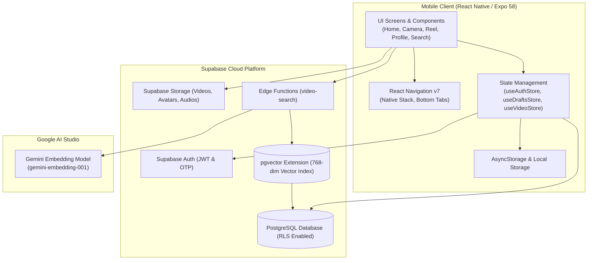

# 8ThreadsTV - Short-Form Video Sharing Platform

Nền tảng chia sẻ và sáng tạo video ngắn trên thiết bị di động, tích hợp tìm kiếm ngữ nghĩa bằng AI (Gemini AI Semantic Search) và hạ tầng đám mây Supabase.

[](https://expo.dev/)
[](https://reactnative.dev/)
[](https://www.typescriptlang.org/)
[](https://supabase.com/)
[](https://ai.google.dev/)
[](https://jestjs.io/)
[](LICENSE)

---

## Mục lục

- [Giới thiệu](#giới-thiệu)
- [Điểm nổi bật về kỹ thuật](#điểm-nổi-bật-về-kỹ-thuật)
- [Tính năng chính](#tính-năng-chính)
- [Kiến trúc hệ thống](#kiến-trúc-hệ-thống)
- [Công nghệ sử dụng (Tech Stack)](#công-nghệ-sử-dụng-tech-stack)
- [Cấu trúc mã nguồn](#cấu-trúc-mã-nguồn)
- [Hướng dẫn cài đặt và khởi chạy](#hướng-dẫn-cài-đặt-và-khởi-chạy)
  - [Yêu cầu tiên quyết](#yêu-cầu-tiên-quyết)
  - [Cài đặt thư viện](#cài-đặt-thư-viện)
  - [Cấu hình biến môi trường](#cấu-hình-biến-môi-trường)
  - [Khởi chạy ứng dụng](#khởi-chạy-ứng-dụng)
- [Cấu hình Backend và Semantic Search](#cấu-hình-backend-và-semantic-search)
- [Kiểm thử và Đảm bảo chất lượng (QA)](#kiểm-thử-và-đảm-bảo-chất-lượng-qa)
- [Kế hoạch phát triển (Roadmap)](#kế-hoạch-phát-triển-roadmap)
- [Giấy phép](#giấy-phép)

---

## Giới thiệu

8ThreadsTV là ứng dụng di động hỗ trợ người dùng quay, biên tập, xuất bản và xem video ngắn. Hệ thống được thiết kế hướng tới hiệu năng cao, trải nghiệm chuyển động mượt mà trên màn hình cảm ứng, và khả năng mở rộng dữ liệu thông qua cơ chế phân tầng chặt chẽ.

Dự án được xây dựng và kiểm thử dựa trên tài liệu đặc tả yêu cầu phần mềm và tài liệu thiết kế hệ thống (SRS/SDS V1.0), đáp ứng các tiêu chuẩn bảo mật dữ liệu cấp cơ sở dữ liệu (Row Level Security - RLS) và tích hợp tìm kiếm thông minh bằng mô hình nhúng vector (Vector Embeddings).

---

## Điểm nổi bật về kỹ thuật

- Tìm kiếm ngữ nghĩa bằng AI (Semantic Video Search): Ứng dụng mô hình `gemini-embedding-001` (Google Gemini) để tạo vector đặc trưng 768 chiều từ dữ liệu tiêu đề, mô tả và chủ đề của video. Cơ sở dữ liệu Supabase sử dụng tiện ích mở rộng `pgvector` để tính toán khoảng cách cosine, cho phép tìm kiếm chính xác theo ý định người dùng thay vì chỉ đối khớp chuỗi ký tự.
- Xử lý đa phương tiện trực tiếp trên thiết bị (Native Media Pipeline): Sử dụng `expo-camera`, `expo-video` và `expo-audio` để tối ưu hóa việc quay, phát và xử lý luồng âm thanh/video mà không gây nghẽn giao diện người dùng. Hỗ trợ áp dụng bộ lọc màu thông qua shader GPU.
- Quản lý bản nháp cục bộ (Offline Drafts Engine): Cho phép lưu trữ trạng thái video, siêu dữ liệu và cấu hình chưa hoàn thiện vào bộ nhớ cục bộ thiết bị, hỗ trợ xem trước toàn màn hình trước khi đẩy lên máy chủ.
- Kiểm soát quyền truy cập và dữ liệu: Kiểm soát phân quyền bằng chính sách Row Level Security (RLS) của PostgreSQL, bảo vệ API và hạn chế tần suất truy vấn (Rate Limiting).
- Bộ kiểm thử toàn diện: Bao gồm 69 ca kiểm thử (TC01 - TC69) bao phủ cả Unit Test và Integration Test dựa trên đặc tả kỹ thuật.

---

## Tính năng chính

### 1. Bảng tin video (Home Feed)
- Trình phát video dọc lướt vô tận với cơ chế tải trước và tái sử dụng bộ phát để tiết kiệm tài nguyên bộ nhớ.
- Tương tác thời gian thực: Thích video, mở danh sách bình luận dạng Bottom Sheet mà không làm dừng luồng phát video, chia sẻ liên kết.
- Phân loại video theo danh mục chủ đề và hiển thị video đang thịnh hành.

### 2. Quay và biên tập video (Camera & Creation)
- Quay video chuẩn HD với các mức giới hạn thời gian (tối đa 180 giây) và dung lượng tệp (tối đa 100MB).
- Chức năng điều khiển: Lật ống kính trước/sau, bật/tắt đèn trợ sáng, hẹn giờ đếm ngược (3 giây, 10 giây).
- Chọn nhạc nền từ kho âm thanh số và lồng tiếng trực tiếp vào video.
- Áp dụng bộ lọc màu video thời gian thực.
- Hỗ trợ tải video có sẵn từ thư viện thiết bị.

### 3. Đăng bài và Quản lý bản nháp (Post & Drafts)
- Cung cấp giao diện nhập tiêu đề, mô tả, chọn chủ đề và thiết lập chế độ hiển thị (Công khai, Bạn bè, Riêng tư).
- Lưu trữ bản nháp trên bộ nhớ máy (Drafts) và cho phép xem lại toàn màn hình.
- Tải tệp đa phương tiện lên Supabase Storage và đồng bộ bản ghi vào cơ sở dữ liệu.

### 4. Tìm kiếm video (Search Engine)
- Tìm kiếm lai (Hybrid Search): Kết hợp tìm kiếm từ khóa truyền thống và tìm kiếm vector ngữ nghĩa thông qua Supabase Edge Function.
- Bộ lọc nâng cao theo thời gian tải lên, số lượt xem và độ dài video.
- Tìm kiếm tài khoản người dùng và bài hát/âm thanh.

### 5. Hồ sơ người dùng (User Profile & Social)
- Quản lý thông tin tài khoản: Ảnh đại diện, tên hiển thị, tên định danh, tiểu sử.
- Thống kê tương tác: Số lượng video, số người theo dõi, số tài khoản đang theo dõi, tổng lượt thích.
- Tab điều hướng nội dung: Danh sách video đã tải lên, video đã thích và video ở chế độ riêng tư.
- Cơ chế theo dõi (Follow/Unfollow) giữa các tài khoản.

### 6. Xác thực và Cài đặt hệ thống (Authentication & Settings)
- Đăng ký tài khoản mới và xác minh mã OTP 6 chữ số qua thư điện tử.
- Đăng nhập bảo mật, lưu giữ và khôi phục phiên làm việc (Session) tự động qua AsyncStorage.
- Cập nhật thông tin tài khoản và đổi mật khẩu.
- Chế độ trải nghiệm khách (Guest Mode) có cơ chế chặn các hành động yêu cầu quyền đăng nhập bằng Modal điều hướng.

---

## Kiến trúc hệ thống



---

## Công nghệ sử dụng (Tech Stack)

| Phân tầng | Công nghệ / Thư viện | Mục đích sử dụng |
| :--- | :--- | :--- |
| **Nền tảng di động** | React Native 0.88, Expo SDK 58 | Phát triển ứng dụng di động đa nền tảng |
| **Ngôn ngữ** | TypeScript 6.0 | Kiểm soát kiểu dữ liệu tĩnh và chuẩn hóa cấu trúc mã |
| **Điều hướng** | React Navigation v7 | Điều hướng màn hình (Native Stack và Bottom Tabs) |
| **Phần cứng & Media** | expo-camera, expo-video, expo-av, expo-audio | Tương tác phần cứng máy ảnh, micro và phát đa phương tiện |
| **Xử lý hình ảnh** | react-native-image-filter-kit, expo-image-picker | Bộ lọc màu shader và chọn tệp từ thư viện ảnh |
| **Cơ sở dữ liệu & Auth** | Supabase (PostgreSQL, Storage, Auth) | Quản lý dữ liệu quan hệ, phiên đăng nhập và lưu trữ tệp |
| **Trí tuệ nhân tạo** | Google Gemini API (`gemini-embedding-001`), pgvector | Tính toán và lưu trữ vector nhúng cho tìm kiếm ngữ nghĩa |
| **Quản lý trạng thái** | AsyncStorage, Store Hooks tùy biến | Lưu trữ cục bộ và quản lý trạng thái luồng dữ liệu phản ứng |
| **Kiểm thử** | Jest, jest-expo, ts-jest | Kiểm thử tự động đơn vị (Unit) và tích hợp (Integration) |

---

## Cấu trúc mã nguồn

```
video-sharing-app/
├── assets/                     # Tài nguyên tĩnh của ứng dụng
├── docs/                       # Tài liệu đặc tả kỹ thuật (SRS, SDS)
│   └── CAMERA_SCREEN.md        # Đặc tả chi tiết màn hình Camera
├── supabase/                   # Cấu hình dịch vụ Supabase
│   ├── functions/              # Mã nguồn Deno Edge Functions
│   │   └── video-search/       # Xử lý vector nhúng và tìm kiếm video
│   ├── migrations/             # Kịch bản SQL tạo bảng, chỉ mục và chính sách bảo mật
│   └── README.md               # Hướng dẫn thiết lập hạ tầng tìm kiếm ngữ nghĩa
├── src/
│   ├── api/                    # Cấu hình máy khách API và các hàm gọi dịch vụ HTTP
│   ├── components/             # Các thành phần giao diện tái sử dụng
│   │   ├── auth/               # Biểu mẫu và modal xác thực
│   │   ├── buttons/            # Các nút tùy biến
│   │   ├── cards/              # Thẻ hiển thị video, âm thanh, chủ đề
│   │   ├── common/             # Thành phần dùng chung (Avatar, Logo, Divider)
│   │   └── profile/            # Thành phần hiển thị hồ sơ cá nhân
│   ├── config/                 # Cấu hình ứng dụng toàn cục
│   ├── constants/              # Biến hằng số, bảng màu và quy chuẩn hệ thống
│   ├── hooks/                  # Các custom hook mở rộng logic giao diện
│   ├── navigation/             # Bộ điều phối AppNavigator và BottomTabNavigator
│   ├── screens/                # Giao diện màn hình theo nghiệp vụ
│   │   ├── audio/              # Màn hình danh sách nhạc nền
│   │   ├── auth/               # Đăng nhập, đăng ký, xác thực OTP
│   │   ├── camera/             # Màn hình quay phim, xem lại và chuẩn bị đăng tải
│   │   ├── drafts/             # Quản lý và xem lại bản nháp
│   │   ├── home/               # Bảng tin hiển thị video
│   │   ├── notification/       # Thông báo tương tác
│   │   ├── profile/            # Quản lý trang cá nhân và theo dõi người dùng
│   │   ├── reel/               # Trình phát video độc lập toàn màn hình
│   │   ├── search/             # Màn hình tìm kiếm và lọc kết quả
│   │   ├── settings/           # Cài đặt ứng dụng và đổi mật khẩu
│   │   └── video-list/         # Danh sách video theo chuyên mục
│   ├── services/               # Tầng xử lý nghiệp vụ và tương tác cơ sở dữ liệu
│   ├── store/                  # Quản lý trạng thái ứng dụng toàn cục
│   ├── types/                  # Định nghĩa kiểu dữ liệu TypeScript
│   └── utils/                  # Hàm tiện ích xử lý định dạng, lưu trữ và xác thực dữ liệu
├── test/                       # Mã nguồn kiểm thử hệ thống
│   ├── doc/                    # Bộ kiểm thử TC01 - TC69 theo tài liệu kiểm thử
│   │   ├── unit.doc.test.ts
│   │   └── integration.doc.test.ts
│   └── mocks/                  # Dữ liệu và dịch vụ giả lập môi trường thử nghiệm
├── app.json                    # Tệp cấu hình dự án Expo
├── package.json                # Danh mục phụ thuộc và lệnh thực thi
└── tsconfig.json               # Cấu hình trình biên dịch TypeScript
```

---

## Hướng dẫn cài đặt và khởi chạy

### Yêu cầu tiên quyết

- Node.js phiên bản 18.x trở lên.
- Quản lý gói: `npm` hoặc `pnpm`.
- Thiết bị di động đã cài đặt ứng dụng **Expo Go** hoặc môi trường máy ảo Android Emulator / iOS Simulator.

### Cài đặt thư viện

1. Sao chép kho mã nguồn về máy:
   ```bash
   git clone https://github.com/your-username/video-sharing-app.git
   cd video-sharing-app
   ```

2. Tiến hành cài đặt các gói phụ thuộc:
   ```bash
   npm install
   ```

### Cấu hình biến môi trường

Tạo tệp `.env` tại thư mục gốc của dự án với nội dung cấu hình sau:

```env
EXPO_PUBLIC_API_BASE_URL=https://your-api.mockapi.io
EXPO_PUBLIC_SUPABASE_URL=https://your-project-id.supabase.co
EXPO_PUBLIC_SUPABASE_KEY=your-supabase-anon-key
```

*Lưu ý: Không đặt các khóa bảo mật quản trị (như `SUPABASE_SERVICE_ROLE_KEY` hoặc `GEMINI_API_KEY`) vào tệp `.env` của ứng dụng di động để tránh rủi ro giải mã gói cài đặt.*

### Khởi chạy ứng dụng

Chạy lệnh phát triển:

```bash
npm start
```

- Nhấn phím `a` để mở ứng dụng trên Android Emulator hoặc thiết bị kết nối ADB.
- Nhấn phím `i` để mở ứng dụng trên iOS Simulator (yêu cầu macOS).
- Quét mã QR trên màn hình console thông qua ứng dụng Expo Go trên điện thoại.

---

## Cấu hình Backend và Semantic Search

Hệ thống tìm kiếm video sử dụng kết hợp giữa cơ sở dữ liệu Supabase và dịch vụ Edge Function:

1. Kích hoạt tiện ích mở rộng vector:
   Truy cập **Database > Extensions** trên giao diện điều khiển Supabase và bật `vector`.

2. Thực thi các bản cập nhật cơ sở dữ liệu:
   Chạy các tệp script trong thư mục `supabase/migrations/` theo thứ tự thời gian:
   - `20261111000000_video_post_storage_policies.sql`
   - `20261111010000_semantic_video_search.sql`
   - `20261111020000_gemini_video_search_embeddings.sql`

3. Thiết lập biến bí mật cho Edge Function:
   Trên trang quản trị Supabase, vào **Edge Functions > Secrets** và cấu hình hai khóa:
   - `GEMINI_API_KEY`: Khóa truy cập tạo từ Google AI Studio.
   - `VIDEO_SEARCH_INDEXER_SECRET`: Chuỗi khóa riêng biệt bảo vệ tiến trình đồng bộ dữ liệu.

4. Triển khai dịch vụ Edge Function:
   ```bash
   supabase functions deploy video-search
   ```

Chi tiết quy trình xử lý hàng đợi và cấu hình có thể tham khảo tại [supabase/README.md](supabase/README.md).

---

## Kiểm thử và Đảm bảo chất lượng (QA)

Hệ thống được kiểm thử tự động với bộ ca kiểm thử bao phủ toàn bộ chức năng cốt lõi (TC01 - TC69 theo tài liệu kiểm thử):

- **Kiểm thử đơn vị (`test/doc/unit.doc.test.ts`)**: Kiểm tra tính hợp lệ của dữ liệu đầu vào (tên hiển thị, độ dài email, định dạng mật khẩu, giá trị biên), logic xử lý chuỗi và các dịch vụ độc lập.
- **Kiểm thử tích hợp (`test/doc/integration.doc.test.ts`)**: Kiểm tra chu trình kết hợp giữa luồng xác thực, bình luận, theo dõi tài khoản, tương tác video và lưu trữ bản nháp.

### Các lệnh thực thi kiểm thử

Thực thi toàn bộ bộ kiểm thử:
```bash
npm test
```

Thực thi kiểm thử ở chế độ theo dõi (Watch mode):
```bash
npm run test:watch
```

Xuất báo cáo độ phủ mã nguồn:
```bash
npm run test:coverage
```

Kiểm tra định dạng và tính toàn vẹn kiểu dữ liệu:
```bash
npm run lint
npx tsc --noEmit
```

---

## Kế hoạch phát triển (Roadmap)

- [x] Triển khai luồng xác thực qua mã OTP và quản lý phiên làm việc.
- [x] Xây dựng màn hình Camera quay video kèm tính năng hẹn giờ, lật ống kính và trợ sáng.
- [x] Tích hợp bộ lọc màu video thông qua shader.
- [x] Xây dựng bảng tin phát video dạng dọc và tương tác người dùng.
- [x] Triển khai hệ thống lưu trữ bản nháp cục bộ.
- [x] Tích hợp cơ chế tìm kiếm video theo ngữ nghĩa sử dụng Gemini AI và Supabase pgvector.
- [ ] Tính năng nhắn tin trực tiếp giữa người dùng (Direct Messaging).
- [ ] Tính năng phát sóng trực tiếp (Live Streaming).
- [ ] Công cụ cắt ghép video nâng cao trên thiết bị.

---

## Giấy phép

Dự án được phân phối theo giấy phép phần mềm mã nguồn mở MIT. Xem chi tiết tại tệp [LICENSE](LICENSE).
